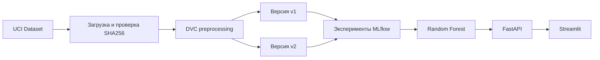

# Airfoil Noise MLOps

Воспроизводимый MLOps-проект для прогнозирования уровня аэродинамического шума авиационного профиля.

Модель получает пять аэродинамических параметров и прогнозирует масштабированный уровень звукового давления в децибелах.

## Датасет

Используется [NASA Airfoil Self-Noise](https://archive.ics.uci.edu/dataset/291/airfoil+self+noise) из UCI Machine Learning Repository.

Датасет содержит 1503 наблюдения и следующие признаки:

| Признак | Описание |
|---|---|
| `frequency` | Частота, Гц |
| `angle_of_attack` | Угол атаки, градусы |
| `chord_length` | Длина хорды, м |
| `free_stream_velocity` | Скорость свободного потока, м/с |
| `suction_side_displacement_thickness` | Толщина вытеснения пограничного слоя, м |
| `scaled_sound_pressure` | Целевая переменная, дБ |

Разбиение данных зафиксировано с `random_state=42`:

| Часть выборки | Количество строк |
|---|---:|
| Train | 1052 |
| Validation | 225 |
| Test | 226 |

Тестовая выборка используется только для окончательной оценки выбранной модели.

## Архитектура



## Версии preprocessing

- `v1` — пять исходных признаков;
- `v2` — исходные признаки и два логарифмических признака:
  `log_frequency` и `log_suction_side_displacement_thickness`.

Обе версии используют одинаковое фиксированное разбиение данных, поэтому результаты моделей можно сравнивать корректно.

## Эксперименты

Для каждой версии preprocessing обучались три модели:

- Ridge;
- Random Forest;
- Gradient Boosting.

Всего выполнено шесть запусков MLflow. Основная метрика выбора — MAE на validation-выборке.

| Модель | Preprocessing | MAE | RMSE | R² |
|---|---|---:|---:|---:|
| Random Forest | v1 | 1.5741 | 2.1164 | 0.9082 |
| Random Forest | v2 | 1.5765 | 2.1123 | 0.9086 |
| Gradient Boosting | v1 | 2.2346 | 3.0332 | 0.8115 |
| Gradient Boosting | v2 | 2.2349 | 3.0332 | 0.8115 |
| Ridge | v2 | 3.8094 | 5.0821 | 0.4709 |
| Ridge | v1 | 3.9128 | 5.0536 | 0.4768 |

Победителем стала модель Random Forest с preprocessing `v1`.

Полная таблица находится в
[`reports/experiment_results.csv`](reports/experiment_results.csv).

## Финальная оценка

После выбора модели train и validation были объединены. Модель была повторно обучена на 1277 строках и один раз проверена на 226 тестовых строках.

| Метрика | Значение |
|---|---:|
| Test MAE | 1.4446 |
| Test RMSE | 1.9284 |
| Test R² | 0.9165 |

Итоговые метаданные находятся в
[`reports/final_test_metrics.json`](reports/final_test_metrics.json).

## Используемые технологии

- Python 3.12;
- uv — окружение и зависимости;
- pandas и scikit-learn;
- DVC — воспроизводимая подготовка данных;
- MLflow — учёт параметров, метрик и моделей;
- FastAPI и Uvicorn — HTTP API;
- Streamlit — пользовательский интерфейс;
- pytest и Ruff — тестирование и проверка кода;
- Docker и Docker Compose — контейнеризация.

## Структура проекта

```text
configs/                    конфигурация проекта
data/                       данные и DVC-метаданные
reports/                    результаты экспериментов
src/airfoil_noise/
├── api/                    FastAPI и загрузка модели
├── data/                   загрузка и preprocessing
├── modeling/               модели, метрики и обучение
└── ui/                     интерфейс Streamlit
tests/                      автоматические тесты
Dockerfile                  образ приложения
compose.yaml                запуск API и Streamlit
dvc.yaml                    DVC-конвейер
pyproject.toml              зависимости и команды
```

## Подготовка окружения

Требуются Python 3.12, Git и uv.

```powershell
git clone https://github.com/karmanik47/airfoil-noise-mlops.git
cd airfoil-noise-mlops
uv sync
```

Активация `.venv` необязательна: команды `uv run` автоматически используют окружение проекта.

## Воспроизведение данных

```powershell
uv run download-data
uv run dvc repro
uv run dvc status
```

Ожидаемый статус:

```text
Data and pipelines are up to date.
```

## Запуск экспериментов

```powershell
uv run run-experiments
```

Результаты сохраняются в MLflow и в `reports/experiment_results.csv`.

Запуск интерфейса MLflow:

```powershell
uv run mlflow server --backend-store-uri sqlite:///mlflow.db --port 5000
```

После запуска MLflow доступен по адресу:

```text
http://127.0.0.1:5000
```

## Обучение финальной модели

```powershell
uv run train-final-model
```

Команда создаёт:

```text
models/model.joblib
models/metadata.json
reports/final_test_metrics.json
```

Каталог `models` не хранится в Git, поэтому перед первым запуском API или сборкой Docker-образа модель необходимо обучить.

## Локальный запуск API

```powershell
uv run serve-api
```

Адреса:

- API: `http://127.0.0.1:8000`;
- документация Swagger: `http://127.0.0.1:8000/docs`;
- проверка состояния: `http://127.0.0.1:8000/health`.

Пример запроса:

```json
{
  "frequency": 1000.0,
  "angle_of_attack": 5.0,
  "chord_length": 0.15,
  "free_stream_velocity": 55.0,
  "suction_side_displacement_thickness": 0.003
}
```

Запрос отправляется методом `POST` на `/predict`.

## Локальный запуск Streamlit

Сначала запустите API, затем в отдельном терминале:

```powershell
uv run streamlit run src/airfoil_noise/ui/app.py
```

Интерфейс доступен по адресу:

```text
http://127.0.0.1:8501
```

## Запуск через Docker

Перед сборкой должна существовать обученная модель:

```powershell
Test-Path models\model.joblib
Test-Path models\metadata.json
```

Запуск API и Streamlit:

```powershell
docker compose up --build
```

После запуска доступны:

- Streamlit: `http://127.0.0.1:8501`;
- FastAPI: `http://127.0.0.1:8000`;
- Swagger: `http://127.0.0.1:8000/docs`.

Проверка контейнеров:

```powershell
docker compose ps
```

Остановка:

```powershell
docker compose down
```

## Проверка качества

```powershell
uv run pytest
uv run ruff check .
uv run dvc status
docker compose config --quiet
```

Проект содержит 21 автоматический тест для конфигурации, загрузки и обработки данных, моделей, метрик, финального разбиения, API и клиента Streamlit.