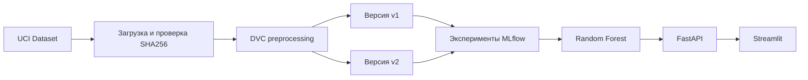

# Airfoil Noise MLOps

Воспроизводимый MLOps-проект для прогнозирования уровня аэродинамического шума авиационного профиля.

Модель получает пять аэродинамических параметров и прогнозирует масштабированный уровень звукового давления в децибелах.

Дополнительная документация:

- [карточка датасета](DATASET_CARD.md);
- [карточка модели](MODEL_CARD.md);
- [итоговый отчёт](REPORT.md).

## Датасет

Используется [NASA Airfoil Self-Noise](https://archive.ics.uci.edu/dataset/291/airfoil+self+noise) из UCI Machine Learning Repository.

Датасет содержит 1503 наблюдения и следующие поля:

| Поле | Назначение |
|---|---|
| `frequency` | Частота, Гц |
| `angle_of_attack` | Угол атаки, градусы |
| `chord_length` | Длина хорды, м |
| `free_stream_velocity` | Скорость свободного потока, м/с |
| `suction_side_displacement_thickness` | Толщина вытеснения пограничного слоя, м |
| `scaled_sound_pressure` | Целевая переменная, дБ |

Разбиение данных зафиксировано с `random_state=42`:

| Часть выборки | Количество строк | Назначение |
|---|---:|---|
| Train | 1052 | Обучение моделей |
| Validation | 225 | Выбор модели |
| Test | 226 | Финальная оценка |

Тестовая выборка не используется для выбора модели или гиперпараметров.

Подробное описание происхождения, лицензии, признаков и ограничений находится в [`DATASET_CARD.md`](DATASET_CARD.md).

## Архитектура



Путь данных:

1. Датасет загружается из UCI.
2. Проверяется SHA256 архива и исходного файла.
3. DVC создаёт две версии preprocessing.
4. MLflow сохраняет параметры, метрики и модели экспериментов.
5. Выбирается лучшая модель.
6. Модель сохраняется как `model.joblib`.
7. FastAPI загружает модель и выполняет inference.
8. Streamlit обращается к FastAPI через HTTP.
9. Docker Compose запускает API и Streamlit вместе.

## Версии preprocessing

### Версия v1

Содержит пять исходных признаков без добавления производных признаков.

SHA256:

```text
c4539e0edffd13ea296e0d657ffa9845a839a5d4fee77da1472160b8c9b7e3c0
```

### Версия v2

Содержит исходные признаки и два дополнительных:

```text
log_frequency
log_suction_side_displacement_thickness
```

Они рассчитываются с помощью `log1p`.

SHA256:

```text
b966fc4a6ac537b2d9eb1ea18ccb494ccfb3b0d65d33b7f2509c6203a06957b4
```

Обе версии используют одинаковое фиксированное разбиение данных, поэтому результаты моделей сравниваются по одной методике.

## Эксперименты

Для каждой версии preprocessing обучались три модели:

- Ridge;
- Random Forest;
- Gradient Boosting.

Всего выполнено шесть запусков MLflow. Основная метрика выбора — MAE на validation-выборке.

| Модель | Preprocessing | MAE | RMSE | R² |
|---|---|---:|---:|---:|
| Random Forest | v1 | 1.5741 | 2.1164 | 0.9082 |
| Random Forest | v2 | 1.5765 | 2.1123 | 0.9086 |
| Gradient Boosting | v1 | 2.2346 | 3.0332 | 0.8115 |
| Gradient Boosting | v2 | 2.2349 | 3.0332 | 0.8115 |
| Ridge | v2 | 3.8094 | 5.0821 | 0.4709 |
| Ridge | v1 | 3.9128 | 5.0536 | 0.4768 |

Победителем стала модель Random Forest с preprocessing `v1`, поскольку она показала минимальную validation MAE.

Версия `v1` также проще версии `v2`, так как использует пять признаков вместо семи.

Полная таблица:

[`reports/experiment_results.csv`](reports/experiment_results.csv)

## Финальная оценка

После выбора модели train и validation были объединены. Модель была повторно обучена на 1277 строках и один раз проверена на 226 тестовых строках.

| Метрика | Значение |
|---|---:|
| Test MAE | 1.4446 |
| Test RMSE | 1.9284 |
| Test R² | 0.9165 |

Итоговые метаданные:

[`reports/final_test_metrics.json`](reports/final_test_metrics.json)

Подробное описание модели и её ограничений:

[`MODEL_CARD.md`](MODEL_CARD.md)

## Используемые технологии

- Python 3.12;
- uv — окружение и зависимости;
- pandas — работа с таблицами;
- scikit-learn — модели машинного обучения;
- DVC — версионирование данных и preprocessing;
- MLflow — параметры, метрики и model artifacts;
- FastAPI — HTTP API;
- Uvicorn — сервер API;
- Pydantic — схемы и валидация;
- Streamlit — пользовательский интерфейс;
- pytest — автоматические тесты;
- Ruff — форматирование и статическая проверка;
- Docker и Docker Compose — контейнеризация.

## Структура проекта

```text
configs/                    конфигурация проекта
data/                       DVC-метаданные
reports/                    результаты экспериментов
scripts/                    автоматический smoke-тест
src/airfoil_noise/
├── api/                    FastAPI и загрузка модели
├── data/                   загрузка и preprocessing
├── modeling/               модели, метрики и обучение
└── ui/                     интерфейс Streamlit
tests/                      автоматические тесты
DATASET_CARD.md             описание датасета
MODEL_CARD.md               описание итоговой модели
REPORT.md                   итоговая проверка проекта
Dockerfile                  образ приложения
compose.yaml                запуск API и Streamlit
dvc.yaml                    DVC-конвейер
dvc.lock                    зафиксированное состояние DVC
pyproject.toml              зависимости и команды
uv.lock                     точные версии зависимостей
```

## Подготовка окружения

Требуются:

- Git;
- Python 3.12;
- uv;
- Docker Desktop — для контейнерного запуска.

Клонирование итоговой версии:

```powershell
git clone --branch v1.0.0 https://github.com/karmanik47/airfoil-noise-mlops.git
cd airfoil-noise-mlops
uv sync
```

Активация `.venv` необязательна. Команды `uv run` автоматически используют окружение проекта.

Если активация нужна:

```powershell
.venv\Scripts\Activate.ps1
```

## Воспроизведение данных

Загрузка исходного датасета:

```powershell
uv run download-data
```

Запуск DVC-конвейера:

```powershell
uv run dvc repro
```

Проверка состояния:

```powershell
uv run dvc status
```

Ожидаемый результат:

```text
Data and pipelines are up to date.
```

Команда `download-data` проверяет SHA256 архива и исходного файла.

## Запуск экспериментов

```powershell
uv run run-experiments
```

Команда запускает шесть экспериментов:

- три модели;
- две версии preprocessing.

Для каждого запуска сохраняются:

- параметры модели;
- validation MAE;
- validation RMSE;
- validation R²;
- версия preprocessing;
- SHA256 датасета;
- SHA256 исходных данных;
- Git commit SHA;
- model artifact.

Результаты сохраняются в MLflow и в:

```text
reports/experiment_results.csv
```

Запуск MLflow:

```powershell
uv run mlflow server --backend-store-uri sqlite:///mlflow.db --port 5000
```

Интерфейс MLflow:

```text
http://localhost:5000
```

## Получение финальной модели

### Вариант 1: скачать artifact релиза

Создать каталог:

```powershell
New-Item -ItemType Directory -Force models | Out-Null
```

Скачать модель:

```powershell
Invoke-WebRequest `
    -Uri "https://github.com/karmanik47/airfoil-noise-mlops/releases/download/v1.0.0/model.joblib" `
    -OutFile "models/model.joblib"
```

Скачать метаданные:

```powershell
Invoke-WebRequest `
    -Uri "https://github.com/karmanik47/airfoil-noise-mlops/releases/download/v1.0.0/metadata.json" `
    -OutFile "models/metadata.json"
```

### Вариант 2: воспроизвести обучение

Сначала необходимо получить и подготовить данные:

```powershell
uv run download-data
uv run dvc repro
```

Затем:

```powershell
uv run train-final-model
```

Команда создаёт:

```text
models/model.joblib
models/metadata.json
reports/final_test_metrics.json
```

Проверка SHA256 модели:

```powershell
Get-FileHash models\model.joblib -Algorithm SHA256
```

Ожидаемый SHA256:

```text
38A3ABF4F32306BF67DEFCC660066F5F296E5F0423BCB2D3E17907E60FADBCCFF
```

## Локальный запуск API

Убедитесь, что существуют:

```text
models/model.joblib
models/metadata.json
```

Запустите API:

```powershell
uv run serve-api
```

Адреса:

- API: `http://localhost:8000`;
- Swagger: `http://localhost:8000/docs`;
- состояние модели: `http://localhost:8000/health`.

### Пример `/health`

Запрос:

```powershell
Invoke-RestMethod `
    -Method Get `
    -Uri "http://localhost:8000/health"
```

Ответ:

```json
{
  "status": "ok",
  "service": "airfoil-noise-api",
  "model_name": "random_forest",
  "preprocessing_version": "v1",
  "model_sha256": "38a3abf4f32306bf67defc660066f5f296e5f0423bcb2d3e17907e60fadbccff"
}
```

Endpoint `/health` загружает модель и сообщает о готовности не только процесса API, но и model artifact.

### Пример `/predict`

Тело запроса:

```json
{
  "frequency": 1000.0,
  "angle_of_attack": 5.0,
  "chord_length": 0.15,
  "free_stream_velocity": 55.0,
  "suction_side_displacement_thickness": 0.003
}
```

Пример PowerShell-запроса:

```powershell
$body = @{
    frequency = 1000.0
    angle_of_attack = 5.0
    chord_length = 0.15
    free_stream_velocity = 55.0
    suction_side_displacement_thickness = 0.003
} | ConvertTo-Json
```

```powershell
Invoke-RestMethod `
    -Method Post `
    -Uri "http://localhost:8000/predict" `
    -ContentType "application/json" `
    -Body $body
```

Ответ:

```json
{
  "predicted_scaled_sound_pressure": 131.2960353095238,
  "unit": "dB",
  "model_name": "random_forest",
  "preprocessing_version": "v1",
  "model_sha256": "38a3abf4f32306bf67defc660066f5f296e5f0423bcb2d3e17907e60fadbccff"
}
```

Некорректные значения возвращают HTTP `422` и описание ошибки в поле `detail`.

## Локальный запуск Streamlit

Сначала запустите API. Затем в отдельном терминале выполните:

```powershell
uv run streamlit run src/airfoil_noise/ui/app.py
```

Интерфейс:

```text
http://localhost:8501
```

Streamlit обращается к документированному FastAPI и не содержит отдельную реализацию модели.

Адрес API можно изменить переменной окружения:

```powershell
$env:AIRFOIL_API_URL = "http://localhost:8000"
```

## Запуск через Docker

Docker image использует:

- Python 3.12 с зафиксированным digest;
- uv версии `0.12.21`;
- зависимости из `uv.lock`;
- непривилегированного пользователя `appuser`;
- версионный тег `airfoil-noise-app:1.0.0`.

Перед сборкой должны существовать:

```powershell
Test-Path models\model.joblib
Test-Path models\metadata.json
```

Обе команды должны вернуть:

```text
True
```

Запуск API и Streamlit:

```powershell
docker compose up --build -d
```

Проверка:

```powershell
docker compose ps
```

Оба контейнера должны получить статус:

```text
healthy
```

Доступные адреса:

- Streamlit: `http://localhost:8501`;
- FastAPI: `http://localhost:8000`;
- Swagger: `http://localhost:8000/docs`.

Проверка непривилегированного пользователя:

```powershell
docker compose exec api id
docker compose exec streamlit id
```

В выводе пользователь должен иметь `uid`, отличный от `0`.

## Smoke-тест

При работающих контейнерах выполните:

```powershell
uv run python scripts/smoke_test.py
```

Smoke-тест проверяет:

- готовность модели через `/health`;
- корректный запрос `/predict`;
- HTTP `422` для неправильного запроса;
- доступность `/docs`;
- одинаковый SHA256 модели в `/health` и `/predict`.

Ожидаемый результат:

```text
Проверка API: http://localhost:8000
[OK] /health и загрузка модели
[OK] корректный /predict
[OK] некорректный /predict возвращает 422
[OK] /docs
Smoke-тест успешно пройден
```

Остановка контейнеров:

```powershell
docker compose down
```

## Проверка качества

```powershell
uv run pytest
uv run ruff check .
uv run dvc status
docker compose config --quiet
```

Проект содержит 22 автоматических теста для:

- конфигурации;
- загрузки датасета;
- проверки контрольных сумм;
- preprocessing;
- разбиения данных;
- моделей;
- метрик;
- финального обучения;
- преобразования входных признаков;
- API;
- клиента Streamlit.

## Конфигурация

Основная конфигурация находится в:

```text
configs/config.yaml
```

Она разделена на секции:

- `project`;
- `train`;
- `inference`;
- `tracking`.

Значения, зависящие от среды, можно изменить переменными окружения. Безопасный шаблон находится в `.env.example`.

Реальный `.env` не добавляется в Git.

## Безопасность

В Git и Docker image не добавляются:

- `.env`;
- токены и пароли;
- приватные ключи;
- виртуальное окружение `.venv`;
- локальная база `mlflow.db`;
- каталоги `mlruns` и `mlartifacts`;
- локальные датасеты;
- локальные model artifacts.

Секреты должны передаваться только через переменные окружения или внешнее хранилище секретов.

## Материалы итоговой версии

- Репозиторий: https://github.com/karmanik47/airfoil-noise-mlops
- Tag: `v1.0.0`
- Release: https://github.com/karmanik47/airfoil-noise-mlops/releases/tag/v1.0.0
- Итоговый отчёт: [`REPORT.md`](REPORT.md)
- Карточка модели: [`MODEL_CARD.md`](MODEL_CARD.md)
- Карточка датасета: [`DATASET_CARD.md`](DATASET_CARD.md)